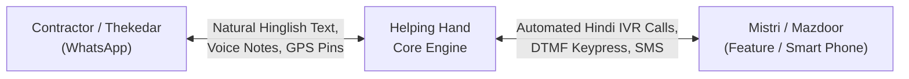
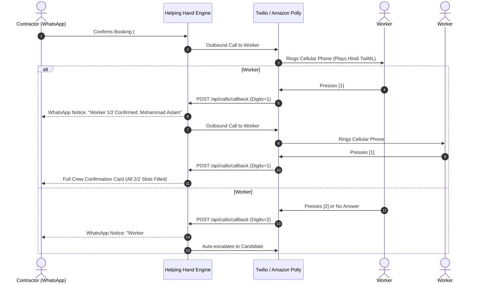
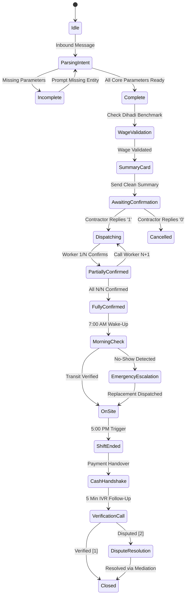

# Helping Hand — WhatsApp Workforce Engine
## Final Product Specification & Architecture (Production Pilot)

---

## 1. Executive Vision & Problem Statement

### 1.1 The Market Reality
Across urban India, over 70 million daily-wage construction and home-service workers gather every morning between 6:30 AM and 8:30 AM at physical street corners known as *Labor Nakas* or *Labor Chowks* (e.g., Sector 62 Chowk in Noida, Atta Market in Sector 27, Indirapuram Chowk, Okhla). 

Contractors (*Thekedars*), small builders, and homeowners travel to these chowks to hire labor through a chaotic, high-friction, and exploitative process:
* **Friction for Contractors**: Wasted morning hours, uncertain worker availability, zero skill verification, and high project-delay risks.
* **Exploitation for Workers**: Aggressive wage undercutting, uncompensated overtime, scope dumping (forcing masons to carry heavy debris), and wage theft (*"kal aana payment lene"*).
* **The No-Show Crisis**: Workers agreeing verbally the night before, then failing to show up at 8:00 AM, stalling construction sites and costing thousands of rupees.

### 1.2 The Product Solution
Helping Hand transforms this informal street corner into an **institutional, automated, two-sided workforce operating system**. 

The contractor interface operates entirely within **WhatsApp** (the universal app already installed on every contractor's phone), requiring zero app downloads. The worker interface operates via **automated cellular IVR voice calls in colloquial Hindi** powered by Amazon Polly neural speech, requiring neither literacy nor a smartphone.



---

## 2. Omnichannel Conversational Gateway (Contractor UX)

### 2.1 Design Philosophy: Zero Emojis, Institutional Dignity
In real-world B2B and institutional utility software, excessive emojis create an impression of promotional marketing spam or unregulated chatbots. The Helping Hand WhatsApp interface uses **clean typography, subtle Unicode dividers, and authoritative, respectful Hindustani/Hinglish copy**.

### 2.2 Multimodal Inputs
The system supports three native input types:
1. **Natural Text**: Full sentences or shorthand Hinglish.
2. **Native WhatsApp GPS Location Pins (📍)**: Reverse geocoded into precise coordinates $(\text{lat}, \text{lng})$ and mapped to nearest human landmarks.
3. **WhatsApp Audio / Voice Notes**: Processed via Speech-to-Text (STT) for contractors on dusty sites who prefer talking over typing.

### 2.3 Smart "One-Shot" Intent & Entity Parser
Rather than forcing busy contractors through a rigid, multi-step questionnaire, the natural language engine extracts all booking entities from a single unstructured message:
* **Trade Category**: Masonry, Labour, Carpentry, Plumbing, Electrical, Painting, Tile/Marble, Welding.
* **Worker Count**: Primary crew count and paired helper counts (e.g., *"1 mistri aur 2 beldar"*).
* **Location & Landmark**: Extracted area, city, and nearest landmark.
* **Offered Wage**: Daily rate in rupees (₹/day).
* **Shift Timing**: Reporting date and morning start time.

If all parameters are present, the bot skips directly to the **Booking Summary Card**. If any parameter is missing, it specifically asks only for what is required.

---

## 3. Dynamic Wage Benchmarking & Lowball Prevention

To prevent silent order abandonment (where workers ignore call offers because the wage is unreasonably low), the engine embeds real-time wage intelligence across Delhi-NCR construction clusters:

| Trade Category | Hindi Title | Min Acceptable Wage | Standard Market Range | Overtime Rate (Pro-Rata + 25%) |
| :--- | :--- | :--- | :--- | :--- |
| **Mason** | Rajmistri | ₹750 / day | ₹850 – ₹1,000 / day | ₹135 / hour |
| **Labour / Helper** | Beldar / Mazdoor | ₹500 / day | ₹550 – ₹650 / day | ₹85 / hour |
| **Carpenter** | Badhai / Shuttering | ₹850 / day | ₹900 – ₹1,100 / day | ₹145 / hour |
| **Plumber** | Nal Mistri | ₹750 / day | ₹800 – ₹1,000 / day | ₹130 / hour |
| **Electrician** | Bijli Mistri | ₹750 / day | ₹800 – ₹1,000 / day | ₹130 / hour |
| **Painter** | Rangai Mistri | ₹700 / day | ₹750 – ₹900 / day | ₹120 / hour |
| **Tile & Marble** | Farsh Mistri | ₹850 / day | ₹900 – ₹1,100 / day | ₹145 / hour |
| **Welder / Rebar** | Sariya Mistri | ₹800 / day | ₹850 – ₹1,000 / day | ₹135 / hour |

### Lowball Wage Warning Logic
If a contractor offers below the minimum threshold (e.g., ₹450 for a Mason):
```text
Helping Hand | Dihadi Advisory
─────────────────────────────────────────
Category: Master Mason (Rajmistri)
Offered Wage: Rs. 450 / day

Notice: Standard daily wage in this sector is Rs. 850 - Rs. 1,000.
At Rs. 450, workers are likely to reject this dispatch.

- Reply '1' to upgrade offer to standard Rs. 850 / day
- Reply '2' to proceed with Rs. 450
─────────────────────────────────────────
```

---

## 4. Priority Matching Engine (Candidate Ranking)

When a booking is confirmed, the system ranks all verified workers in the database using a **multi-factor composite score**:

$$\text{Composite Score} = (S_{\text{dist}} \times 0.50) + (S_{\text{rating}} \times 0.30) + (S_{\text{exp}} \times 0.20)$$

Where:
* **Distance Score ($S_{\text{dist}}$)**: Calculated via the Haversine formula based on straight-line distance between the job coordinates and worker home coordinates.
  $$d = 2R \arcsin\left(\sqrt{\sin^2\left(\frac{\Delta \text{lat}}{2}\right) + \cos(\text{lat}_1)\cos(\text{lat}_2)\sin^2\left(\frac{\Delta \text{lng}}{2}\right)}\right)$$
  Workers within $3\text{ km}$ receive maximum distance score.
* **Rating Score ($S_{\text{rating}}$)**: Normalized from worker customer reviews ($1.0$ to $5.0$).
* **Experience Score ($S_{\text{exp}}$)**: Based on successfully completed and verified shifts on the platform.

Workers are ordered into a prioritized dispatch queue: Candidate #1, Candidate #2, Candidate #3...

---

## 5. Dual-Channel IVR Voice Dispatch & Multi-Worker Fulfillment



### 5.1 Localized Hindi TwiML Script with Noisy Site Retry
Workers often answer on noisy construction sites with cement mixers and traffic. The call flow incorporates an automatic retry before assuming timeout:

```xml
<Response>
    <!-- Primary Gather Prompt -->
    <Gather numDigits="1" action="/api/calls/callback?bookingId=HH-1234&amp;workerId=wrk-001" method="POST" timeout="8">
        <Say voice="Polly.Aditi" language="en-IN">
            Namaste Mohammad Aslam. Helping Hand se urgent kaam ka offer hai. 
            Kaam: Rajmistri. Site: Sector 62 Noida. Dihadi: 850 rupaye prati din. 
            Kaam ki tarikh: Kal subah 8:30 AM. 
            Agar aap kaam par aana chahte hain toh 1 dabayein. Agar busy hain toh 2 dabayein.
        </Say>
    </Gather>
    
    <!-- Noisy Site Retry Prompt -->
    <Gather numDigits="1" action="/api/calls/callback?bookingId=HH-1234&amp;workerId=wrk-001" method="POST" timeout="7">
        <Say voice="Polly.Aditi" language="en-IN">
            Aapki aawaz nahi aayi. Kaam lene ke liye 1 dabayein, vyast hain toh 2 dabayein.
        </Say>
    </Gather>
    
    <Say voice="Polly.Aditi" language="en-IN">
        Koi uttar nahi mila. Kaam agle mistri ko diya ja raha hai. Shukriya.
    </Say>
    <Redirect method="POST">/api/calls/callback?bookingId=HH-1234&amp;workerId=wrk-001&amp;digits=TIMEOUT</Redirect>
</Response>
```

---

## 6. End-of-Shift Protection & Wage Dispute Resolution

### 6.1 Digital Work Order (Contractual Boundary)
Every confirmed booking explicitly itemizes the legal shift boundaries:
1. **Trade Scope**: Specific trade tasks only (e.g., masonry plastering). Out-of-scope work (e.g., plumbing or carrying 50kg debris for masons) is prohibited without booking an additional helper.
2. **Standard Shift**: 8 working hours (e.g., 9:00 AM – 5:00 PM, including 1 hour lunch break).
3. **Overtime Terms**: Pre-fixed hourly overtime rate ($\text{Dihadi} / 8 + 25\%$) required for any work past 5:00 PM.

### 6.2 Automated 5:00 PM Shift-End Alert
At 5:00 PM, an automated notification is delivered to both parties:
* **To Contractor**:
  ```text
  Helping Hand | Shift Notice (#HH-1234)
  ─────────────────────────────────────────
  The scheduled 8-hour shift for Mohammad Aslam has concluded at 5:00 PM.
  
  - If overtime work is required, reply 'OT 1' (1 hr) or 'OT 2' (2 hrs). Overtime rate is Rs. 135/hr.
  - If work is finished, please initiate the end-of-day cash settlement of Rs. 850.
  ─────────────────────────────────────────
  ```

### 6.3 Mutual Cryptographic Cash Handshake
1. The worker counts the physical cash received on site.
2. The worker enters the amount into their interface or confirms via IVR, generating a **4-digit one-time handshake PIN**.
3. The contractor enters this PIN to confirm matching amounts.
4. The system validates that both devices are within **50 meters** of the site location via GPS.

### 6.4 Post-Shift IVR Verification Call (5 Minutes Post-Handshake)
Five minutes after payment is logged, an automated outbound verification call is placed to the worker:
> *"Helping Hand verification call. Kya aapko agreed dihadi aur overtime ka pura bhugtan mil gaya hai? Haan ke liye 1 dabayein, vivad (dispute) ke liye 2 dabayein."*

### 6.5 Dispute Enforcement & Contractor Account Freeze
If the worker presses **2 (Dispute / Underpayment)**:
1. **Immediate Account Suspension**: The contractor's hiring account is frozen across all active sites. No new dispatches are permitted.
2. **Mediation Notice**: The contractor receives a detailed WhatsApp dispute notice specifying the missing overtime or wage amount with a direct UPI resolution link.
3. **Blacklisting**: Contractors with unresolved disputes after 24 hours are permanently banned and reported to affiliated contractor associations.
4. **Platform Wage Guarantee Fund**: Verified workers receive disputed wages (up to ₹500) from a platform reserve fund, which is later recovered from the contractor.

---

## 7. Morning "No-Show" Shield (7:00 AM Transit Verification)

To eliminate the fear of workers failing to show up on site:
1. **Automated 7:00 AM Wake-Up Call**:
   * Placed to all confirmed workers 90 minutes before shift start.
   * Voice prompt: *"Namaste Aslam. Aaj subah 8:30 AM Sector 62 site par aapka kaam hai. Kya aap site ke liye nikal rahe hain? Haan ke liye 1 dabayein, mana karne ke liye 2 dabayein."*
2. **Transit Confirmation**:
   * If Worker presses **1**: Contractor receives WhatsApp confirmation:  
     `"Notice: Worker Mohammad Aslam has confirmed transit and is en route to site on schedule."`
3. **Emergency Auto-Replacement**:
   * If Worker presses **2** or misses the call by 7:15 AM:
   * The system **instantly dials Candidate #2 in the standby queue**.
   * Contractor is notified:  
     `"Transit Alert: Worker #1 was unavailable this morning. Emergency backup worker Dharmendra Yadav has been auto-dispatched to ensure zero delay."`

---

## 8. Real-World Technical Edge Cases & Safeguards



### 8.1 Webhook Idempotency (Deduplication)
Meta WhatsApp webhooks retry on latency. An in-memory/Redis TTL cache stores `message.id` (`wamid...`) for 120 seconds. Any duplicate webhook delivery returns `200 OK EVENT_RECEIVED` immediately without triggering double dispatches.

### 8.2 Stale Session Timeout (TTL)
Sessions expire after **45 minutes** of contractor inactivity. If a contractor replies hours later, the bot resets state cleanly rather than placing unwanted calls late at night.

### 8.3 Quiet-Hours Safeguard (10:00 PM – 6:45 AM)
Bookings created late at night are acknowledged immediately on WhatsApp, but outbound IVR phone calls to workers are queued and placed at **6:45 AM** to respect worker sleep and privacy.

### 8.4 Mid-Stream Contractor Cancellation
If a contractor cancels after workers are already dispatched:
1. Cancellation WhatsApp message / automated call is placed to the workers:  
   `"Notice: Thekedar dwara Booking #HH-1234 cancel kar di gayi hai. Aapka schedule free kar diya gaya hai."`
2. Worker availability is immediately unlocked (`isAvailable: true`).

### 8.5 Landmark Reverse Geocoding
Workers cannot navigate to raw coordinates like `28.6255, 77.3690`. Site locations are parsed to human landmarks (e.g., *"Near Fortis Hospital, Sector 62, Gate 2"*), and contractor direct contact numbers are provided in the dispatch SMS.

---

## 9. Technology Stack

* **Conversational Interface**: Meta WhatsApp Cloud API (Node.js, Express).
* **Telephony & Speech**: Twilio Voice API, Amazon Polly (`Polly.Aditi`, bilingual Indian English / Hindi neural voice).
* **Geospatial Engine**: OpenStreetMap Nominatim API, Haversine Spherical Distance Algorithm.
* **Core API & State**: Node.js (ESM), TypeScript, Express.js.
* **Database & Caching**: PostgreSQL (Persistent shifts, ledger, workers), Redis (Session TTL, cash handshake, idempotency).

---

## 10. Operational Metrics & Key Performance Indicators (KPIs)

1. **Fulfillment Speed**: Target $< 90\text{ seconds}$ from contractor confirmation to primary worker acceptance.
2. **No-Show Rate**: Target $< 3\%$ through 7:00 AM transit verification and auto-replacement.
3. **Wage Dispute Rate**: Target $< 1.5\%$ of completed shifts through 5:00 PM shift-end alerts and mutual cash handshakes.
4. **Contractor Retention**: Target $> 65\%$ repeat booking rate within 30 days.

